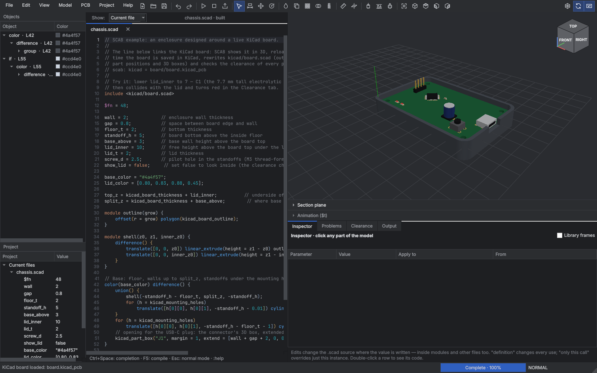
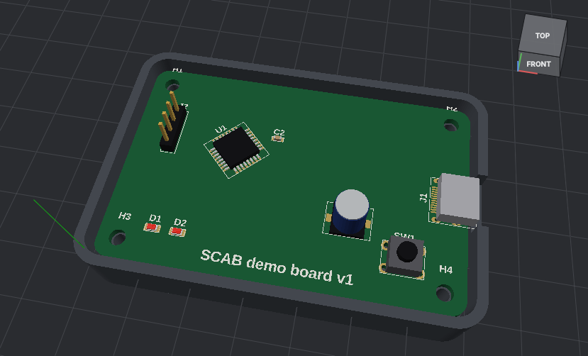
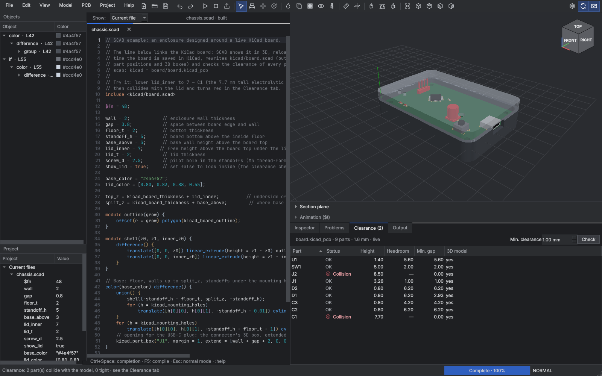

# SCAB

A source-first desktop CAD editor for **OpenSCAD**, aimed at designing complex 3D
PCB assemblies (board shape, mounting holes, parts, enclosures) before taking the
board to **KiCad**. Every action edits ordinary `.scad` text — OpenSCAD stays the
geometry authority, your files stay portable.

## Highlights

| | |
|---|---|
| **Click the model → edit what made it** | The Inspector shows the clicked primitive, every module call above it (in any file, any depth), the colors in effect, loop values and the variables it uses. Edit a value and press Enter: the change is written *where the value is defined* (e.g. `config.scad:5`), or as an override on just that call. Module defaults, colors and global variables are all editable. |
| **Complete Vim mode** | Motions, operators, text objects, counts, visual / line / block mode, registers and the system clipboard, `.` repeat, macros, marks, jump list, search with highlighting, and ex commands (`:s`, `:g`, `:normal`, `:sort`, …). |
| **See where the SCAD is wrong** | Syntax errors are flagged while you type. OpenSCAD errors and warnings (including failed `assert`s and the module call chain) are mapped back to the right file and line: gutter dots, wavy underline, hover text with a hint, a clickable **Problems** panel, and `:cn` / `:cp` to jump between them. |
| **Fast compiles of large models** | The Rust engine expands the design once, splits it into pieces, **instances identical geometry** (vias, screws, repeated parts are meshed once), meshes in parallel and caches by content. Editing one part recompiles one part. |
| **KiCad export** | `PCB → Export KiCad board…` writes a `.kicad_pcb` with the exact Edge.Cuts outline (true arcs), holes and footprints placed by library id, plus a placement CSV. |
| **Live KiCad board** | `PCB → Load KiCad board…` shows the real board — outline, pads, holes and the footprints' 3D models — in the same 3D view as your SCAD chassis, and reloads every time you save in KiCad. A generated include gives OpenSCAD the outline, holes and part positions, and the **Clearance** tab flags parts that collide with or come too close to the chassis (e.g. a capacitor that is too tall for the lid). |





Measured on a PCB-like test model (board with 200 drilled holes + 600 placed
components, CGAL backend): first compile **242 s → 7.5 s**, recompile after
changing one component **235 s → 0.16 s**.

## Getting started

Requirements: [OpenSCAD](https://openscad.org) (2021.01 or newer; a 2023+ build
with the Manifold backend is much faster), Python 3.10+, and optionally
[Rust](https://rustup.rs) for the fast compile engine.

```bash
bash run.sh                      # Linux / macOS
bash run.sh path/to/model.scad   # open a file
bash run.sh examples/pcb_project # open a project folder
```

On Windows run `run.bat`. The scripts create `.venv`, install
`requirements.txt`, build `rust-engine` when `cargo` is available, then start
the app. If OpenSCAD is not on `PATH`, use *Settings → OpenSCAD path…* or set
`OPENSCAD_BINARY`.

Try `examples/parametric_mount.scad` (opened at start-up) and
`examples/pcb_project/` (multi-file project with the PCB library).

## Working in the window

* One header bar: menus on the left, tools as icons (hover for the name and
  shortcut). Toggles on the right: draft mesh, build while typing, Vim.
* Model tools: **Inspect** (I), **Dimension handles** (D), **Move** (G),
  **Rotate** (R), plus color, duplicate, pattern, boolean, thread, measure and
  section plane. Right-click the model, the object list or the editor for the
  same operations on the selected object.
* Views: Fit (F), Isometric (0), Top (7), Front (1), Right (3), or click the
  view cube. Left drag orbits, Shift+drag pans, Ctrl+drag rolls, wheel zooms.
* **Measure**: click two points (on the model or the KiCad board).
* `File → Save view as PNG`, `File → Open recent`; files changed by another
  program are reloaded automatically when they have no unsaved edits.

## The Inspector

1. Compile (F5, or automatically while typing).
2. Click any part of the model. A yellow box outlines the primitive; the
   Inspector lists its parameters grouped by where they come from:
   * the primitive call (`cylinder(d = hole_d, …)`),
   * each enclosing module call (`led(c = "lime")`, `standoff()`), with
     all parameters — also defaults that were not passed,
   * `color()`, transforms, `for` loops (the loop value of the clicked instance)
     and `if` conditions,
   * the global variables used by any of these.
3. Edit a value and press **Enter** (mouse wheel or ↑/↓ nudge the number under
   the cursor; Shift ×0.1, Ctrl ×10). Colors open a color picker with live
   preview. The **Apply to** column chooses where the edit goes:
   * `variable x → value · config.scad:3` — change the definition (all uses),
   * `default of led(d) → value · parts.scad:2` — change the module default,
   * `only this call` — replace the argument at this call, or add a missing
     `name = value` argument to this call only.
4. The model recompiles and the Inspector re-picks the same point.
   Every edit is a normal text edit: `u` in that file undoes it.

Library internals (BOSL2, `lib/`, OpenSCAD library paths) are collapsed; tick
*Library frames* to see them. Double-click any row to jump to its source.

Imported meshes (`import()`), and constructs the tracer cannot evaluate, fall
back to selecting the top-level object.

## Vim

Vim mode is on by default (toolbar checkbox; the setting is remembered). The
mode and pending keys are shown in the status bar.

* **Motions:** `h j k l` `w W b B e E ge gE` `0 ^ $ g_ _ |` `+ - Enter` `gg G {n}G`
  `H M L` `{ }` `( )` `%` `[( [{ ]) ]}` `f F t T ; ,` `/ ? n N * # g* g#`
  `` ` ' `` marks, `Ctrl-O` / `Ctrl-I` jumps, `gd` / `K` / `Ctrl-]` (definition, project-wide)
* **Operators:** `d c y > < =` (re-indent) `g~ gu gU` `gc` (toggle `//` comments) — with any
  motion or text object, `dd cc yy >> gcc …`, counts everywhere (`d3w`, `3dd`, `2>>`)
* **Text objects:** `iw aw iW aW is as ip ap i( a( ib ab i{ a{ iB aB i[ a[ i< a< i" a" i' a'`
  (repeat `i(` in visual mode to grow to the outer block)
* **Editing:** `x X s S r R J gJ D C Y p P gp gP ~ u Ctrl-R .`, `Ctrl-A` / `Ctrl-X`
  increment numbers (handy for dimensions), `i a I A o O gi gI`
* **Visual:** `v V Ctrl-V`, `o`, `gv`; block `I` / `A` insert on all lines, `r`, `c`, `p`
* **Registers:** `"a`–`"z`, `"A` (append), `"0`–`"9`, `"-`, `"_`, `"+`/`"*` (system clipboard).
  `clipboard=unnamedplus` is the default, so `y` / `p` work with other applications.
* **Macros & repeat:** `qa … q`, `@a`, `@@`, `3@a`, `.` with counts
* **Insert mode:** auto-indent, `{` Enter `}` block expansion, `Ctrl-W Ctrl-U`,
  `Ctrl-R {reg}`, `Ctrl-O` (one normal command), `Ctrl-T Ctrl-D`, `Ctrl-N` / `Ctrl-Space` completion
* **Ex:** `:w :q :wq :x :q! :wa :e file :{n}` `:s/pat/rep/gi :%s :'<,'>s :& g&`
  `:g/pat/cmd :v/pat/cmd :normal :d :y :m :t :co :j :> :< :sort [n|i|u] :pu`
  `:noh :set (ic scs hls is ws sw ts sts et cb rnu …) :reg :marks :delm :undo :redo`
  `:make` (compile) `:cn :cp :copen` (errors) `:bn :bp :b{n}` (tabs) `:kicad :export :inspect`
* Search uses Vim regex syntax (`\<word\>`, `\(group\)`, `\v` very magic, `\c`), with
  incremental search and match highlighting.

`:set rnu` shows relative line numbers for count-based jumps.

## Errors and warnings

* The live parser marks syntax errors as you type (missing `;`, unclosed
  brackets, …) at the exact line and column.
* After a compile, every `ERROR:` / `WARNING:` from OpenSCAD is shown in the
  file where it occurs — also in included / used files, which open in a tab when
  you click the entry. `TRACE` lines (the chain of module calls) appear under
  the error. A short hint explains the common cases (unknown variable from a
  `use <>` file, misspelled parameter, missing `;` reported on the next line…).
* A failed `assert()` or other fatal error keeps the previous mesh visible.

## Live KiCad board and clearance check

Design the enclosure while the board is still changing:

1. `PCB → Load KiCad board…` (or put `// scab: kicad = path/to/board.kicad_pcb`
   in the SCAD file so the board loads with it). The board appears in the 3D view
   at its real position: outline and cutouts from Edge.Cuts, drilled holes,
   pads, silkscreen (outlines and text, top and bottom) and every footprint's
   3D model — STEP (`.step`, read with OpenCASCADE through the optional
   `cascadio` package that `run.sh` installs) or VRML (`.wrl`), whichever the
   footprint references, with the other one as a fallback. Parts without a
   model show their courtyard box. KiCad paths such as `${KIPRJMOD}` and
   `${KICAD8_3DMODEL_DIR}` are resolved.
2. Each time KiCad saves the board, SCAB reloads it, rewrites
   `kicad/<board>.scad` next to your file and rebuilds.
3. `include <kicad/board.scad>` gives you, in board coordinates (mm, origin at
   the KiCad aux/drill origin or the board's lower-left corner, Z = 0 at the
   bottom of the board):
   * `kicad_board_outline`, `kicad_board_size`, `kicad_board_thickness`,
     `kicad_board_holes`, `kicad_mounting_holes`, `kicad_board_cutouts`;
   * `kicad_parts` — reference, value, footprint, position, rotation, side and
     the 3D bounding box of every part; `kicad_part("J1")` looks one up;
   * `kicad_part_box("J1", margin, extend)` — a box for connector cutouts;
   * `kicad_pcb()` — the board (and parts) as geometry.
4. The **Clearance** tab lists every part with its height above the board, the
   headroom above it (below it for bottom-side parts), the smallest gap to the
   model, and whether it collides. Collisions are red and tight parts amber —
   in the list and on the 3D board. Set the minimum clearance at the top.

**Printing the chassis:** `File → Export chassis parts…` (Shift+F6) writes
one STL per top-level object (e.g. `chassis-base.stl`, `chassis-lid.stl`),
named after the comment above the object or its module. Objects that draw the
KiCad board (`kicad_pcb()`) and objects disabled with `%`/`*` are left out.

`examples/kicad_chassis/` is a complete example: a KiCad 7 project with its own
3D models (`board/`) and `chassis.scad`, an enclosure whose walls follow the
board outline, with standoffs on the mounting holes, a USB-C cutout taken from
the connector's 3D box and a lid with holes over the button and LEDs. Lower
`lid_inner` to 7 and the 7.7 mm capacitor turns red. `tools/make_example_board.py`
regenerates the board.

## PCB → KiCad workflow

1. `PCB → Insert PCB library + example board` copies
   [`assets/scab/pcb.scad`](assets/scab/pcb.scad) into your project
   (`lib/scab/pcb.scad`) and adds an example.
2. Design with ordinary OpenSCAD, using:
   * `pcb_board(size, thickness, radius, outline) { cutters }`
   * `pcb_hole(pos, d)`, `pcb_mounting_hole(ref, pos, d, footprint)`
   * `pcb_part(ref, footprint, pos, rot, side, body, color, value) { 3D body }`
   * `pcb_connector(...)` — same as a part, different default look.

   They can live inside your own modules, loops and transforms; the export uses
   their real world position.
3. `PCB → Export KiCad board…` (`Ctrl+Shift+K`, `:kicad`) writes
   `name.kicad_pcb` and `name-placement.csv`.
4. In KiCad open the board and run **Tools → Update Footprints from Library**
   to load the pads of every placed footprint, then add the schematic netlist
   (*Update PCB from Schematic*, matching by reference) and route.

Without `pcb_board()`, the outline comes from an OpenSCAD cross-section through
the model (the construction plane if shown, otherwise near the bottom of the
model). The construction plane panel can also export any section as a DXF for
KiCad Edge.Cuts.

## How compiling works

* The UI wraps each top-level object in a marker and runs OpenSCAD **once** per
  animation frame to export evaluated CSG.
* `rust-engine` splits each object into pieces (unions, groups, colors and
  transforms are distributed; `difference`, `hull`, extrusions … stay intact,
  so the result is still exact OpenSCAD geometry), keys pieces by their code
  without the placement, and meshes unique pieces in parallel
  (`SCAB_WORKERS`, default: CPU count). Results are cached in
  `.scab-cache/` by content (including bytes of imported files).
* Meshes are loaded with NumPy and instanced on the GPU side; nothing heavy runs
  on the UI thread.
* Projects compile in place; when unsaved buffers differ from disk, the tree is
  mirrored with hard links and only edited files are written.
* *Draft mesh* caps `$fn` at 24 for preview only.

Environment knobs: `OPENSCAD_BINARY`, `SCAB_ENGINE`, `SCAB_USE_RUST=0`,
`SCAB_WORKERS`, `SCAB_MAX_TASKS`, `SCAB_TIMEOUT_SECONDS`,
`SCAB_MAX_MESH_MB`, `SCAB_CACHE_DIR`, `SCAB_STRICT=1`.

## Development

```bash
pip install -r requirements-dev.txt
python -m pytest tests            # Vim engine, parser/tracer, inspector, KiCad, Qt editor
(cd rust-engine && cargo test)
```

Layout:

| Path | |
|---|---|
| `scab/vim.py` | Qt-independent Vim engine (fully unit tested) |
| `scab/editor.py` | Qt editor: Vim adapter, highlighting, completion, diagnostics |
| `scab/lang.py` | OpenSCAD parser with exact source spans |
| `scab/trace.py` | Evaluator / tracer: primitives, world transforms, call chains |
| `scab/inspector.py`, `inspector_panel.py` | Value provenance and the Inspector UI |
| `scab/diagnostics.py`, `problems.py` | Error parsing / mapping and the Problems panel |
| `scab/kicad.py` | `.kicad_pcb` / CSV export |
| `scab/kicad_import.py`, `vrml.py`, `step.py` | KiCad board, silkscreen and 3D model (VRML / STEP) import, generated SCAD include |
| `scab/export_parts.py` | One STL per chassis object |
| `scab/clearance.py`, `clearance_panel.py` | Part-versus-chassis collision / headroom / gap check |
| `scab/icons.py` | Line icon set (drawn SVG) |
| `tools/make_example_board.py` | Generates the example KiCad project |
| `scab/native_engine.py`, `meshio.py` | Rust engine bridge, NumPy STL loading and instancing |
| `rust-engine/` | Parallel, content-addressed OpenSCAD scheduler |
| `assets/scab/pcb.scad` | PCB helper library |
| `assets/BOSL2/` | Bundled [BOSL2](https://github.com/BelfrySCAD/BOSL2) (BSD-2) for the thread tool |

Third-party: BOSL2 © Revar Desmera and contributors, BSD 2-Clause (see
`assets/BOSL2/LICENSE`).
